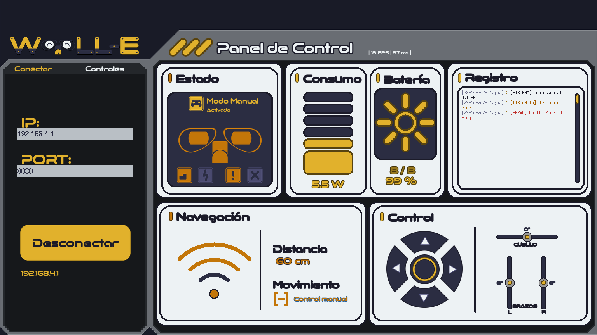

# 🤖 Wall-E Robot (ESP32 + App de escritorio)

<p align="center">
  
</p>

<p align="center">El robot ESP32 autónomo de código abierto, controlado por WiFi desde una app de escritorio en Python.</p>

<p align="center">
  <a href="LICENSE"></a>
  
  
</p>

<p align="center">
  [](https://hub.xerj.org/contributors/kevingamezb)
</p>

---

Un robot Wall-E autónomo y controlado por WiFi basado en el chip **ESP32**. Cuenta con una
arquitectura desacoplada de software, una aplicación de escritorio interactiva y un sistema de
actualización inalámbrica (OTA).

---

<p align="center">
  
</p>

## ✨ Características principales

* **🧠 Navegación autónoma segura:** bucle no bloqueante (`millis()`), evasión de obstáculos y
  parada automática si no hay lectura fresca del sensor. Arranca detenido y no avanza a ciegas.
* **💻 App de escritorio:** panel modular en Python (Tkinter); la conexión TCP se abre en un hilo
  aparte, con socket no bloqueante y refresco por eventos (`after`).
* **🔌 Reconexión automática:** si el robot se apaga o se aleja, la app reintenta con espera
  creciente (1 → 10 s) sin bloquear la interfaz.
* **🎮 Control manual explícito:** botón **MODO** (manual/automático); el gamepad solo manda en
  manual. En manual, el firmware detiene los motores a los 2 s sin órdenes.
* **📡 Telemetría en tiempo real:** WiFi/TCP con mensajes JSON de una línea (`\n`) y protocolo
  versionado.
* **⚡ Actualizaciones inalámbricas:** OTA con validación MD5, autenticación obligatoria y guardia
  de rollback.
* **✅ Verificable:** suite de pytest con cobertura, cajones de prueba por módulo y tests nativos
  de la lógica de decisión del firmware.

## 📋 Requisitos

| Componente | Requisito |
|---|---|
| PC | Python **3.10+** con Tkinter y [Pillow](https://python-pillow.org/) |
| Robot | ESP32 con PlatformIO (VS Code o CLI) |
| Red | WiFi del robot (**WPA2**, red `WALL-E`) |

## 📦 Descargas

Cada push a `main` publica (y actualiza) la release
[**latest**](https://github.com/kevingamezb/wall-e-robot/releases/latest):

| Plataforma | Archivo |
|---|---|
| Windows 10/11 | `Wall-E.exe` (autocontenido, sin instalar Python) |
| Debian / Ubuntu / Mint | `wall-e_<versión>_amd64.deb` |
| Windows (paquete completo) | `wall-e-<versión>-win64.zip` |
| Linux (paquete completo) | `wall-e-<versión>-linux64.zip` |
| Firmware ESP32 | `firmware.bin` + `firmware.bin.md5` |

Los ZIP incluyen la app, el firmware, un `LEEME.md` y `SHA256SUMS.txt`. La
release añade un `SHA256SUMS.txt` con los hashes de todos los archivos.

En Windows basta con ejecutar `Wall-E.exe`. En Debian/Ubuntu/Mint:

```bash
sudo apt install ./wall-e_<versión>_amd64.deb
```

Los pull request compilan los mismos artefactos, pero no publican release.

## 🚀 Inicio rápido (app)

Desde la raíz del repositorio:

```bash
python -m pip install -r requirements.txt
python -m app.main
```

La app arranca **sin conexión**. En la barra lateral escribe la IP del robot
(`192.168.4.1` por defecto) y pulsa **CONECTAR**. Para el desarrollo y las pruebas:

```bash
python -m pip install -r requirements-dev.txt
python -m pytest
python pruebas/ejecutar_cajones.py
```

## 🔧 Firmware (ESP32)

El proyecto PlatformIO se abre/invoca desde **la raíz del repositorio**.

1. Crea las credenciales (no se versionan):

   ```bash
   cp firmware/include/secrets.example.h firmware/include/secrets.h
   ```

   Define `WIFI_AP_CLAVE` (8+ caracteres), `OTA_USUARIO` y `OTA_CLAVE` (8+
   caracteres). Sin `secrets.h` el build **falla a propósito**: no se permite un
   AP abierto ni un portal OTA sin clave.

2. Compila y flashea:

   ```bash
   pio run
   pio run -t upload
   pio device monitor
   ```

3. Prueba la lógica pura del firmware sin hardware:

   ```bash
   pio test -e native
   ```

> `pio test -e native` necesita un compilador host (`g++`). En Windows puede no
> estar instalado; el CI lo ejecuta en Ubuntu.

## 🧪 Pruebas y CI

| Qué | Cómo |
|---|---|
| Suite de la app | `python -m pytest` |
| Cobertura (mínimo 80 %) | `python -m pytest --cov=app --cov-report=term-missing --cov-fail-under=80` |
| Cajones por módulo | `python pruebas/ejecutar_cajones.py` |
| Firmware ESP32 | `pio run` |
| Decisión autónoma (nativa) | `pio test -e native` |

El workflow [`.github/workflows/ci.yml`](.github/workflows/ci.yml) ejecuta los
jobs de app (pytest + cobertura + cajones) y firmware (compilación + tests
nativos) en cada push/PR a `main`.

El workflow [`.github/workflows/release.yml`](.github/workflows/release.yml)
compila en cada push/PR a `main`:

* **Windows:** `Wall-E.exe` (PyInstaller `--onefile`, sin Python) y el ZIP.
* **Linux (Ubuntu 22.04):** `wall-e_<versión>_amd64.deb` y el ZIP.
* **Firmware:** `firmware.bin` + `firmware.bin.md5`, compilado una sola vez y
  reutilizado por ambas plataformas.

En un **push a `main`** publica o actualiza la release móvil `latest` con todos
esos archivos. En un **pull request** solo los sube como artefactos del
workflow (los PR de forks no reciben secrets ni permiso de escritura). El
firmware de PR usa credenciales de CI ficticias; la release real exige los
secrets `WIFI_AP_CLAVE`, `OTA_USUARIO` y `OTA_CLAVE` del repositorio.

## 📁 Estructura

```text
wall-e-robot/
├── app/            # App de escritorio (Python + Tkinter)
│   ├── comunicacion/   # TCP + JSON, reconexión y parseo tolerante
│   ├── nucleo/         # Estado, paleta y diseño
│   ├── pantallas/      # Pantalla principal y modales
│   └── widgets/        # Lógica y renderizado de widgets
├── firmware/       # Firmware ESP32 (PlatformIO)
│   ├── include/        # config.h, pines.h y secrets.example.h
│   ├── lib/            # Módulos: auto, decision, distancia, motores, OTA…
│   ├── src/            # main.cpp
│   └── test/           # Tests nativos (Unity)
├── tests/          # Suite pytest de la app
├── pruebas/        # Runner de cajones y guía de pruebas
├── scripts/        # Empaquetado y manifiesto del firmware
├── configuracion/  # Mapeo de teclas persistente
└── platformio.ini
```

## 🛡️ Seguridad y comportamiento ante fallos

* El AP WiFi y el portal OTA exigen credenciales; el firmware se niega a compilar
  sin ellas.
* En **automático**, el robot se detiene si no hay eco o si la última medición
  tiene más de 750 ms. Si se cae la conexión con la app, **sigue navegando solo**.
* En **manual**, si dejan de llegar órdenes durante 2 s, los motores se detienen.
* Cualquier cambio manual ↔ automático detiene los motores antes del siguiente
  movimiento.
* Los mensajes entrantes están limitados a 4 KiB y el protocolo avisa si la app
  usa una versión más nueva.

La matriz completa de pruebas de seguridad física está en
[`pruebas/guia_de_pruebas.md`](pruebas/guia_de_pruebas.md) (§5.4).

## 📚 Documentación

* [Guía de pruebas y operación](pruebas/guia_de_pruebas.md): cajones, pytest,
  firmware, OTA, protocolo y checklist.
* [Esquema de conexión](esquema_de_conexion.md): cableado del robot.

## 📄 Licencia

Este proyecto está bajo la Licencia **GPL-3.0**. Consulta [`LICENSE`](LICENSE) para más detalles.
