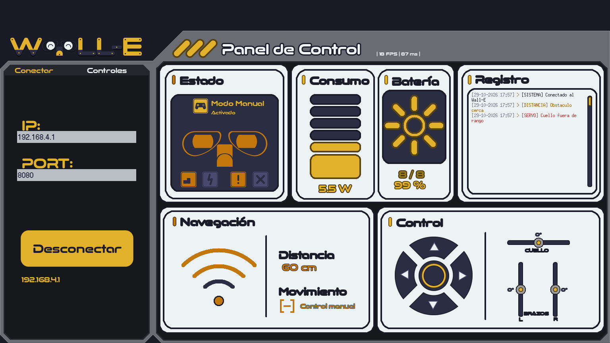

# 🤖 Wall-E Robot

<p align="center">
  
</p>

<p align="center">El robot ESP32 autónomo de código abierto, controlado por WiFi desde una app de escritorio en Python.</p>

<p align="center">
  <a href="LICENSE"></a>
  
  
</p>

<p align="center">
  <a href="https://hub.xerj.org/contributors/kevingamezb"></a>
</p>

La aplicación muestra la distancia a obstáculos y el consumo eléctrico, y se reconecta automáticamente si pierde el enlace.



## 📦 Descargas

Descarga los archivos desde la [última versión publicada](https://github.com/kevingamezb/wall-e-robot/releases/latest).

| Plataforma | Archivo | Instalación |
| --- | --- | --- |
| Windows 10/11 | `Wall-E.exe` | Ejecuta el archivo directamente. |
| Debian, Ubuntu y Mint (amd64) | `wall-e_<versión>_amd64.deb` | Instala el archivo con `sudo apt install ./nombre-del-archivo.deb`, usando el nombre descargado. |
| Windows y Linux | `wall-e-<versión>-win64.zip` o `wall-e-<versión>-linux64.zip` | Extrae el paquete. Incluye la aplicación, el firmware y las instrucciones. |
| ESP32 | `firmware.bin` y `firmware.bin.md5` | Usa ambos archivos para actualizar desde el portal OTA. |

La versión publicada incluye `SHA256SUMS.txt` para verificar las descargas.

## 🎮 Uso

### Primer arranque

1. Enciende el robot y conecta el computador a la red abierta `WALL-E`.
2. Abre **Configuración → Wi-Fi y OTA** en la app. En **Acceso OTA actual**, usa el usuario de fábrica `walle` y la contraseña `wall-e-ota`.
3. En **Nuevas credenciales**, introduce la contraseña Wi-Fi, el usuario OTA y la contraseña OTA. Las contraseñas admiten de 8 a 63 caracteres ASCII imprimibles. Pulsa **Guardar y reiniciar**.
4. Cuando reaparezca `WALL-E`, vuelve a conectarte con la nueva contraseña. Si el computador conservó el perfil de la red abierta, olvida esa red y agrégala de nuevo.
5. Pulsa **Conectar** en la app. La dirección predeterminada es `192.168.4.1:8080`.

El portal OTA web y el diálogo de configuración funcionan con el acceso de fábrica mientras la red está abierta. El control remoto de movimiento se habilita al configurar la contraseña Wi-Fi. Realiza la configuración inicial en un lugar controlado. Si actualizas desde una versión que usaba `secrets.h`, sigue estos pasos una vez.

### Cambiar credenciales o recuperar el acceso

El ESP32 conserva las credenciales al apagarlo. Si recuerdas el acceso OTA actual, puedes cambiar las claves en **Configuración → Wi-Fi y OTA**.

Si olvidaste la contraseña Wi-Fi o las credenciales OTA:

1. Con el robot **ya encendido**, mantén pulsado **BOOT** en la placa ESP32 durante cinco segundos para borrar las credenciales guardadas.
2. Suelta **BOOT**. El ESP32 reinicia con la red abierta `WALL-E` y el acceso OTA de fábrica `walle` / `wall-e-ota`.
3. Si tu computador recuerda la red con la contraseña anterior, olvida el perfil guardado. Luego repite los pasos de [Primer arranque](#primer-arranque).

### Controles

Pulsa **MODO** o la tecla **M** para alternar entre control manual y navegación autónoma.

La app recuerda la última dirección que conectó correctamente. Abre **Configuración avanzada** para editar la IP y el puerto.

El robot arranca detenido en modo manual. Si pasan dos segundos sin órdenes de movimiento o el ESP32 detecta que el operador perdió el enlace en manual, se corta el PWM de las ruedas. El arranque automático por inactividad se puede habilitar en el firmware con `AUTOMATICO_SIN_CONEXION`. En modo automático navega sin depender de la aplicación y se detiene si falta el eco del sensor frontal o si la última lectura tiene más de 750 ms.

**Detener** corta el PWM, cancela el modo autónomo o la demo y mantiene el robot detenido incluso tras reconectar. Pulsa el rótulo de modo o **M** para volver al control manual. El botón requiere conexión activa con el firmware que lo admite.

**Demo** ejecuta una animación breve en la OLED con la base quieta. La OLED también parpadea cuando el robot está en reposo. Para habilitar el gesto de cuello y el saludo con un brazo, comprueba primero la holgura del montaje, el recorrido de los cables y la alimentación de 5 V. Luego puedes activar `DEMO_MOVER_SERVOS` en [config.h](firmware/include/config.h).

En automático con la app conectada, **6-7** tiene un 0,1 % de probabilidad cada 5 s y alterna los brazos arriba y abajo con la base quieta. **Vuelta de Ballet** tiene un 2 % cada 10 s cuando el sensor frontal tiene una lectura válida de al menos 45 cm. El robot se detiene, sube un brazo y luego el otro, y gira sobre su eje. **Detener**, salir de automático o perder el enlace cancelan el emote. La vuelta es aproximada. En [config.h](firmware/include/config.h) se pueden ajustar los ángulos de los brazos, el PWM y la duración del giro para el montaje.

Para actualizar por Wi-Fi, abre **Conectar → Abrir Portal OTA** en la aplicación mientras estás en la red del robot. Inicia sesión con las credenciales OTA y carga el binario junto con su archivo MD5 según las indicaciones del portal.

## 🔌 Conexiones

El montaje usa un ESP32, un sensor ultrasónico HC-SR04 fijo al frente, un controlador TB6612FNG con dos motores CC, tres servos MG90S, un sensor de corriente INA219, una pantalla OLED SSD1306 de 0,96″ y tres LED. El firmware define los GPIO y las direcciones I²C en [pines.h](firmware/include/pines.h).

### Alimentación

La batería LiPo 2S de 2000 mAh (8,4 V cargada) alimenta el driver de motores y, mediante un convertidor reductor, el riel de 5 V. El relé o MOSFET realiza el corte físico de alimentación.

| Desde | Hasta | Función |
| --- | --- | --- |
| Positivo de batería | `VIN+` del INA219 | Entrada de corriente medida. |
| `VIN−` del INA219 | `VIN` del relé o MOSFET | Salida del INA219, en serie con la batería. |
| `VOUT` del relé o MOSFET | `VM` del TB6612FNG e `IN+` del convertidor de 5 V | Alimentación de motores y entrada del convertidor. |
| `OUT+` del convertidor de 5 V | `VIN` del ESP32, `VCC` del HC-SR04 y `VCC` de los tres MG90S | Alimentación de 5 V. Los servos toman corriente del convertidor. |
| `OUT+` del convertidor de 5 V | Ánodo del LED verde | Indicador fijo. Si el LED es discreto, usa una resistencia en serie para limitar la corriente. |
| `3V3` del ESP32 | `VCC` del INA219, del OLED y del TB6612FNG | Alimentación lógica de 3,3 V. |
| Negativo de batería | GND del convertidor, ESP32, TB6612FNG, HC-SR04, servos, INA219 y OLED, y cátodos de los tres LED | Tierra común. En el convertidor, `OUT−` va a esta misma tierra. |

### Señales y motores

| Componente | Terminal | Conexión |
| --- | --- | --- |
| HC-SR04 | `TRIG` | GPIO17 |
| HC-SR04 | `ECHO` | GPIO16 mediante el divisor indicado abajo |
| TB6612FNG | `STBY` | GPIO4 |
| TB6612FNG | `PWMA` / `AIN1` / `AIN2` | GPIO25 / GPIO26 / GPIO27 |
| TB6612FNG | `PWMB` / `BIN1` / `BIN2` | GPIO33 / GPIO32 / GPIO14 |
| TB6612FNG | `AO1` / `AO2` | Bornes positivo / negativo del motor A |
| TB6612FNG | `BO1` / `BO2` | Bornes positivo / negativo del motor B |
| MG90S del cuello | Señal | GPIO23 |
| MG90S del brazo izquierdo | Señal | GPIO18 |
| MG90S del brazo derecho | Señal | GPIO19 |
| INA219 (`0x40`) y OLED (`0x3C`) | `SDA` / `SCL` | GPIO21 / GPIO22, bus I²C compartido |
| LED rojo | Ánodo | GPIO13 mediante 220 Ω |
| LED amarillo | Ánodo | GPIO2 mediante 220 Ω |

- **Eco del HC-SR04.** Conecta `ECHO` al GPIO16 mediante una resistencia de 1 kΩ y el GPIO16 a GND mediante una de 2 kΩ. El divisor adapta el eco de 5 V al nivel del ESP32.
- **Bus I²C.** Si los módulos no incorporan resistencias de pull-up, conecta una de 4,7 kΩ desde cada línea (`SDA` y `SCL`) a 3,3 V.
- **Sentido de marcha.** El firmware asigna A a la izquierda y B a la derecha. Confirma esa correspondencia y el sentido de marcha en el montaje. El cableado documentado usa `SENTIDO_MOTORES = -1` en [motores.cpp](firmware/lib/motores/motores.cpp).

## 🛠️ Instalación desde el código fuente

### Aplicación de escritorio

Necesitas Python 3.10 o superior con Tkinter. Desde la raíz del repositorio, instala las dependencias e inicia la aplicación.

```bash
python -m pip install -r requirements.txt
python -m app.main
```

### Firmware del ESP32

1. Abre la raíz del repositorio en PlatformIO.
2. Conecta el ESP32 por USB, compila y carga el firmware.

   ```bash
   pio run
   pio run -t upload
   ```

3. Abre **Configuración → Wi-Fi y OTA** en la app para configurar las credenciales del dispositivo.

## 📄 Licencia

[GNU General Public License v3.0](LICENSE).
