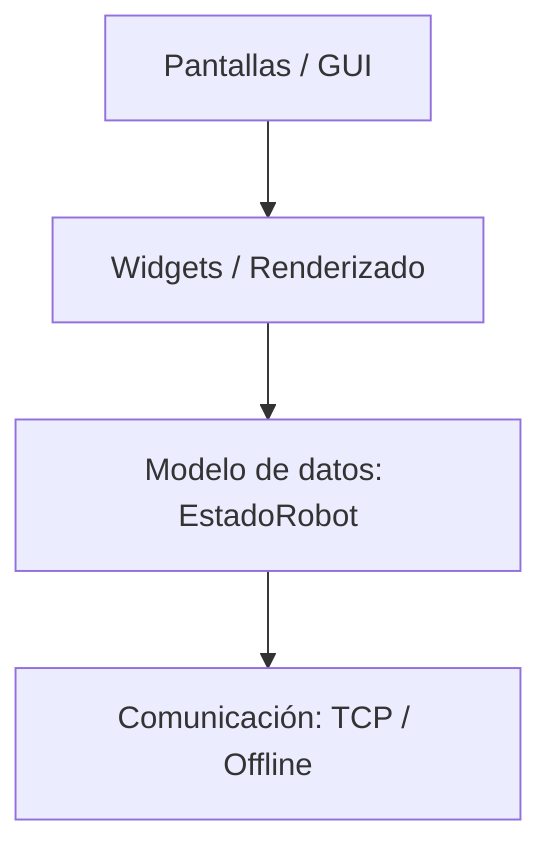

# 🤖 Wall-E Robot (ESP32 + App de escritorio)

<p align="center">
  
</p>

<p align="center">El robot ESP32 autónomo de código abierto, controlado por WiFi desde una app de escritorio en Python.</p>

<p align="center">
  <a href="LICENSE"></a>
  
  
</p>

---

Un robot Wall-E autónomo y controlado por WiFi basado en el chip **ESP32**. Cuenta con una
arquitectura desacoplada de software, una aplicación de escritorio interactiva y un sistema de
actualización inalámbrica (OTA).

Este README es el punto de entrada al repositorio. El detalle de cada tema vive en los documentos
especializados enlazados más abajo.

## ✨ Características principales

* **🧠 Navegación inteligente:** modo autónomo con bucle de control no bloqueante (`millis()`) y evasión de obstáculos.
* **💻 App de escritorio:** panel de control modular en Python (Tkinter); la conexión se abre en un hilo aparte para no congelar la GUI, con socket no bloqueante y refresco por eventos (`after`).
* **🎮 Control manual explícito:** botón **MODO** (manual/automático); el gamepad solo manda en manual.
* **📡 Telemetría en tiempo real:** comunicación bidireccional WiFi/TCP con mensajes JSON de una sola línea (`\n`).
* **⚡ Actualizaciones inalámbricas:** soporte OTA con validación MD5 y guardia de rollback.

## 🏗️ Arquitectura del software

El proyecto separa estrictamente la interfaz, la lógica de comunicación y el control de hardware.

### 📈 Flujo de la aplicación de escritorio

Cada capa solo conoce y consume la capa inmediatamente inferior:



Cuatro capas en el código:

1. **Comunicación** — `app/comunicacion/conexion.py` (`Conexion`, `Comunicacion` TCP, `ConexionOffline`).
2. **Modelo de datos** — `app/nucleo/` (`EstadoRobot`, `Paleta`).
3. **Widgets** — `app/widgets/logica/` (sin Tkinter) + `app/widgets/renderizado/` (con Tkinter).
4. **Pantallas** — `app/pantallas/` (`pantalla_principal.py`, `modal_controles.py`).

`EstadoRobot` es una caja de datos compartida: quien produce información escribe ahí y quien la
consume lee de ahí, sin conocerse entre sí. Los controles interactivos usan callbacks.

### 🧩 Firmware (ESP32)

Una librería por componente bajo `firmware/lib/`, orquestada por `firmware/src/main.cpp` con un
loop no bloqueante (`millis()`, sin `delay()`): `comunicacion`, `servos`, `motores`, `distancia`,
`bateria`, `oled`, `leds`, `auto`, `ota`.

`lib/auto` no tiene hardware propio: decide usando los módulos globales de distancia y motores
(`iniciar()`, `actualizar()`, `modoAutonomo()`, `hayObstaculo()`, `navegacion()`).

Cada módulo de hardware se activa con un flag en
[`firmware/include/config.h`](firmware/include/config.h). Un módulo desactivado no se toca y
reporta valores neutros a la GUI, para no generar alertas falsas por hardware ausente.

## 📡 Comunicación (resumen)

Medio WiFi/TCP, JSON de una línea por mensaje (`\n` como delimitador). El ESP32 actúa como
servidor en modo AP (red `WALL-E`, `192.168.4.1`, puerto `8080`).

- **ESP32 → PC:** `{"tipo":"estado", ...}` (telemetría cada ~500 ms) y `{"tipo":"log", ...}`.
- **PC → ESP32:** `{"tipo":"servo"|"modo"|"motor"|"multi", ...}`.

La app aplica un parseo tolerante: campos ausentes o `null` no pisan el valor anterior, de modo
que firmware viejo y nuevo conviven. El nivel de conexión no viaja en el JSON: la app lo deriva
por la frescura del último estado recibido.

## 🛠️ Especificaciones de hardware

El cerebro del robot es un **ESP32**, que gestiona los siguientes módulos:

* **Actuadores:** 3 servos MG90S (cuello + 2 brazos) alimentados por un buck de 5 V + driver TB6612FNG para 2 motores CC de tracción.
* **Sensores:** HC-SR04 (distancia, fijo al frente) + INA219 (consumo y voltaje, I2C `0x40`).
* **Interfaz física:** OLED SSD1306 0.96" (I2C `0x3C`) para el estado del sistema + 2 LEDs indicadores (rojo/amarillo).

El cableado completo, la alimentación y la tierra común están en
[`esquema_de_conexion.md`](esquema_de_conexion.md), que a su vez remite a los pines canónicos en
[`firmware/include/pines.h`](firmware/include/pines.h).

## 🗂️ Estructura del repositorio

```text
wall-e-robot/
├── app/                    # App de escritorio (Python + Tkinter). Depende de Pillow.
│   ├── nucleo/             # EstadoRobot, Paleta
│   ├── comunicacion/       # TCP/JSON + offline
│   ├── widgets/logica/     # Lógica de widgets (sin Tkinter)
│   ├── widgets/renderizado/# Renderers y helpers de dibujo (con Tkinter)
│   ├── pantallas/          # pantalla_principal, modal_controles
│   ├── recursos/           # Assets PNG (ojos e íconos), teñidos con la Paleta
│   └── main.py             # Arranque de la GUI
├── firmware/               # Firmware del ESP32 (PlatformIO)
│   ├── include/            # pines.h, config.h, secrets.example.h
│   ├── lib/                # Una librería por componente (+ ota)
│   └── src/main.cpp        # Loop no bloqueante
├── configuracion/          # controles.json (mapeo de teclas persistente)
├── pruebas/                # Runner de cajones + guia_de_pruebas.md
├── tests/                  # Suite automatizada con pytest
├── scripts/                # Utilidades de build (empaquetado, manifiesto OTA)
├── esquema_de_conexion.md  # Cableado por componente
├── platformio.ini          # Configuración del build del firmware
├── requirements.txt        # Dependencias de la app (Pillow)
└── requirements-dev.txt    # Dependencias de desarrollo (pytest, pytest-cov)
```

## 🚀 Cómo empezar

### Requisitos previos

- Python 3.10 o superior **con Tkinter**.
  - **Linux (Debian/Ubuntu/Mint):** Tkinter no viene con el sistema:
    `sudo apt install python3-tk python3-venv` (y `python3.12-venv` si usas Python 3.12).
  - **Windows/macOS:** Tkinter viene incluido con el instalador de Python.
- **Pillow**, para cargar y teñir los assets PNG de `app/recursos/` (está en `requirements.txt`).
- **PlatformIO** para el firmware: VS Code con la extensión, o la CLI
  (`python -m pip install platformio`, queda como `pio`).

### 1. Clonar e instalar dependencias

```bash
git clone https://github.com/kevingamezb/wall-e-robot.git
cd wall-e-robot
python -m pip install -r requirements.txt
```

Las dependencias de desarrollo (pruebas) están aparte:

```bash
python -m pip install -r requirements-dev.txt
```

### 2. Ejecutar la app

Desde la **raíz** del repositorio:

```bash
python -m app.main
```

Arranca en **SIN CONEXIÓN** y abre el modal para escribir la IP del robot (por defecto
`192.168.4.1`). El robot reparte los datos, así que hay que estar en su red WiFi y pulsar
**CONECTAR**. Sin conectar, el panel queda apagado (sol de batería en "sin datos", gamepad
deshabilitado). Con conexión, el botón **MODO** alterna manual/automático y el gamepad manda
solo en manual.

### 3. Ejecutar las pruebas

```bash
python -m pytest                 # suite automatizada (tests/)
python pruebas/ejecutar_cajones.py   # cajones manuales heredados
```

Detalles, cobertura y notas de VS Code: [`pruebas/guia_de_pruebas.md`](pruebas/guia_de_pruebas.md).

### 4. Compilar y grabar el firmware

```bash
pio run              # compilar
pio run -t upload    # compilar + grabar por USB
pio device monitor   # monitor serial (115200)
```

Si `pio` no está en el PATH, usa la ruta del entorno:
`~/.platformio/penv/bin/platformio` (Linux/macOS) o
`C:\Users\<usuario>\.platformio\penv\Scripts\platformio.exe` (Windows).

**Linux (flashear por USB):** añade tu usuario al grupo de puertos serie para trabajar sin sudo,
y vuelve a entrar en la sesión:

```bash
sudo usermod -aG dialout $USER
```

Si la placa aparece en `/dev/ttyUSB0` y PlatformIO no la ve, revisa `ls -l /dev/ttyUSB*` tras
conectarla.

**Antes de grabar (configuración local, no versionada):** copia la plantilla de credenciales y
edítala; `secrets.h` está en `.gitignore` y no se publica.

```bash
cp firmware/include/secrets.example.h firmware/include/secrets.h
```

- El **primer** firmware debe grabarse por USB. OTA solo funciona a partir de un build que ya
  incluya el módulo OTA.
- Si la placa no se reinicia sola al grabar (módulos con chip CH340), mantén pulsado **BOOT
  (IO0)** al iniciar la subida y suéltalo cuando empiece; si no arranca, pulsa **EN/RST**.
- Con `WIFI_AP_CLAVE` y `OTA_CLAVE` vacías, el AP y el portal OTA quedan **abiertos**: solo es
  aceptable en la red aislada del robot.

### 5. Actualización OTA (por WiFi)

El firmware incorpora un portal web OTA y `ArduinoOTA` (ver la carpeta `firmware/lib/ota/`), con
verificación por MD5 y una guardia de rollback. Las credenciales se toman de
`firmware/include/secrets.h` (plantilla en
[`firmware/include/secrets.example.h`](firmware/include/secrets.example.h)); ese archivo no se
versiona.

El procedimiento, el manifiesto MD5 y las comprobaciones de rollback están documentados en
[`pruebas/guia_de_pruebas.md`](pruebas/guia_de_pruebas.md) (§7). **La actualización OTA está
implementada y documentada, pero no se declara validada en hardware en este README.**

### 6. Distribución (ejecutables)

`scripts/empaquetar_distribucion.py` genera un ZIP por plataforma con la app empaquetada
(PyInstaller), el firmware de la MISMA versión, `LEEME.md` y `SHA256SUMS.txt`:

```bash
python scripts/empaquetar_distribucion.py                  # paquete completo de esta plataforma
python scripts/empaquetar_distribucion.py --solo-firmware  # solo firmware.bin + .md5
```

PyInstaller **no cross-compila**: cada ZIP se genera en su sistema operativo.

- **Linux (Debian/Ubuntu/Mint):** se genera aquí mismo, `wall-e-<ver>-linux64.zip`.
- **Windows:** se compila en CI (GitHub Actions, `windows-latest`), `wall-e-<ver>-win64.zip`.
- **macOS:** fuera de momento (exigiría firma de Apple para no avisar a Gatekeeper).

En CI, el firmware se compila **una vez** en Linux (el `.bin` del ESP32 es igual desde cualquier
PC) con la clave de distribución —los secrets `WIFI_AP_CLAVE` y `OTA_CLAVE` del repo— y los
builds de Windows lo adjuntan con `--firmware-bin`. Para publicar una versión: sincronizar
`PROYECTO_VERSION` en [`firmware/include/config.h`](firmware/include/config.h), etiquetar
(`git tag v1.0.0 && git push origin v1.0.0`) y el workflow
[`release.yml`](.github/workflows/release.yml) publica el GitHub Release con los ZIPs y el
firmware.

## 📊 Estado del proyecto

- App de escritorio: interfaz completa y usable; requiere el robot (o su red WiFi) para recibir datos.
- Firmware: comunica, lee sensores y mueve servos/motores; integrándose con hardware real.
- Pruebas: suite automatizada (pytest) más los cajones manuales heredados.
- Pendiente: validar cableado y direcciones de motores, calibrar umbrales, afinar la navegación
  autónoma en hardware y validar OTA en el robot.

## 📑 Documentación adicional

* [Esquema de conexión](esquema_de_conexion.md) — cableado físico por componente.
* [Guía de pruebas](pruebas/guia_de_pruebas.md) — operación, protocolo JSON, pruebas y OTA.

## 📄 Licencia

Este proyecto está bajo la Licencia **GPL-3.0**. Consulta [`LICENSE`](LICENSE) para más detalles.
